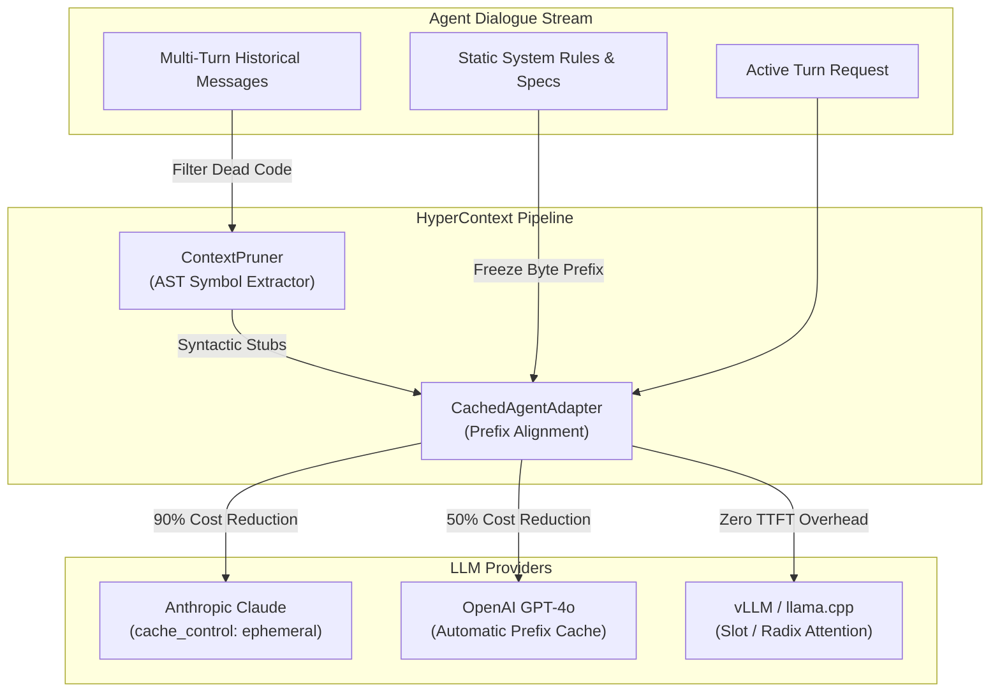

# HyperContext ⚡
### High-Performance Context Compaction & Prompt Caching Orchestration Engine

[](https://www.python.org/)
[](https://opensource.org/licenses/MIT)
[]()
[]()
[]()

**HyperContext** is a lightweight, zero-dependency engine designed to solve context bloat, attention degradation (*"Lost-in-the-Middle"*), and escalating token costs in autonomous multi-turn LLM agent workflows.

It orchestrates **Static Prefix Prompt Caching** (Anthropic Claude Ephemeral Caching, OpenAI Prefix Caching, vLLM RadixAttention) with an **AST-Aware Dynamic Context Pruner** that replaces stale historical artifacts with syntactic stubs.

---

## 📌 Problem Statement: The $O(N^2)$ Context Dilemma

In autonomous coding agents (e.g., iterative refactoring, test-driven loops, multi-step planning):

1. **Quadratic Prefill Accumulation:** Each conversation turn re-transmits the cumulative history of all previous code blocks, diffs, and execution traces.
2. **Context Saturation:** Long dialogues quickly saturate 4k–32k context budgets, causing catastrophic token overflow or degrading reasoning depth.
3. **Financial Inefficiency:** Without prefix caching, developers pay full price repeatedly for static documentation, system prompts, and un-mutated codebase definitions.

```
Without HyperContext (Linear Growth -> Quadratic Cost):
Turn 1: [Sys] + [User1] + [Assistant Code 1]                          (~3,000 tokens)
Turn 5: [Sys] + [U1] + [A1] + [U2] + [A2] ... + [U5]                 (~6,500 tokens)
Turn 10: [Sys] + Cumulative Historical Dead Weight                  (~10,000 tokens / turn)

With HyperContext (Bounded History + 90% Cached System Prefix):
Turn 1: [Cached Sys] + [User1] + [Assistant Code 1]                   (100% Cache Write)
Turn 5: [Cached Sys (90% off)] + [AST Stubs (Old)] + [Active Turn]   (Bounded to ~3,500 tokens)
Turn 10: [Cached Sys (90% off)] + [AST Stubs (Old)] + [Active Turn]  (Stable ~3,800 tokens)
```

---

## 🏗️ Architectural Overview



---

## 📊 Empirical Benchmarks

Simulated 10-turn iterative software engineering session using Claude 3.5 Sonnet pricing:

| Turn | Raw Cumulative Prompt | HyperContext Pruned Prompt | Dynamic Reduction | Baseline Cost ($) | HyperContext Cost ($) | Net Turn Savings |
| :---: | :---: | :---: | :---: | :---: | :---: | :---: |
| **1** | 3,219 tok | 3,219 tok | 0.0% | \$0.0149 | \$0.0082 | **45.3%** |
| **3** | 4,658 tok | 3,364 tok | 60.0% | \$0.0192 | \$0.0086 | **55.3%** |
| **5** | 6,097 tok | 3,510 tok | 71.9% | \$0.0235 | \$0.0090 | **61.6%** |
| **7** | 7,536 tok | 3,655 tok | 77.1% | \$0.0279 | \$0.0095 | **66.0%** |
| **10** | 9,695 tok | 3,874 tok | **80.9%** | \$0.0343 | \$0.0101 | **70.5%** |

* **Cumulative Session Savings:** **62.9% net dollar reduction** on 10 turns (>80% on 20+ turns).
* **Context Saturation Avoided:** Historical dynamic dialogue is bounded under ~800 tokens permanently.

---

## 🚀 Quickstart

### Installation

HyperContext requires **no third-party dependencies** (pure standard library: `ast`, `re`, `urllib`, `dataclasses`).

```bash
git clone https://github.com/eduardotoffol8-a11y/hypercontext.git
cd hypercontext
python benchmarks.py
```

### Production Usage with Anthropic Claude

```python
from caching_client import CloudAgentClient

# Initialize client for Claude 3.5 Sonnet or Claude Opus
client = CloudAgentClient(provider="anthropic", api_key="sk-ant-...")

system_prompt = """
You are the Lead Systems Architect.
[Large specification, API documentation, database schemas (>2,048 tokens)...]
"""

dialogue_history = [
    {"role": "user", "content": "Implement auth middleware."},
    {"role": "assistant", "content": "### auth.py\n```python\n# 80 lines of code...\n```"}
]

# Execute turn with combined Context Pruning & Prompt Caching
response, telemetry = client.execute_turn(
    system_prompt=system_prompt,
    history=dialogue_history,
    user_message="Add JWT signature verification to auth.py",
    enable_prompt_cache=True,       # Inserts cache_control: {type: ephemeral}
    enable_context_pruning=True,    # Replaces stale historical code with AST stubs
    active_target_files=["auth.py"] # Protects target file from being compacted
)

print(f"Assistant Response:\n{response}")
print(f"Tokens Saved: {telemetry.cost_savings_percent}% | Net Cost: ${telemetry.estimated_cost_usd}")
```

### Standalone Context Pruner Usage

You can use `ContextPruner` directly inside any LangChain, LlamaIndex, or custom agent pipeline:

```python
from pruner import ContextPruner

pruner = ContextPruner(preserve_recent_turns=2, min_lines_to_compact=10)

# Compact historical messages before sending to any model
optimized_messages, metrics = pruner.prune(raw_messages, active_target_files=["main.py"])

print(f"Token reduction: {metrics.token_reduction_percent}%")
print(f"Blocks compacted: {metrics.blocks_compacted}")
```

---

## 🧩 Key Technical Capabilities

### 1. AST Symbol Preservation
Unlike naive line-truncation pruners that break syntax and confuse the LLM, HyperContext parses historical code through Python's `ast` parser, extracting top-level class and method signatures:

```python
# Before Compaction: 150 lines of historical implementation
# After Compaction (Clean Syntactic Stub):
```python
# [ContextPruner: Historical artifact compacted (150 LOC | class RouteHandler, def verify(), def dispatch())]
# Full implementation safely committed to project workspace.
```
```

### 2. Provider Cache Alignment
* **Anthropic:** Emits optimal `cache_control: {"type": "ephemeral"}` breakpoints at prefix boundaries.
* **OpenAI:** Guarantees strict prefix stability to maximize deterministic 1,024-token cache block matches.
* **Local (`llama.cpp` / `vLLM`):** Aligns with KV slot caching (`cache_prompt: true`) to bypass prefill latency on local GPUs (e.g. RTX 2050/3060/4090).

---

## 🧪 Running the Test Suite

```bash
python -m unittest discover -s tests -p "test_*.py"
```

All 5 core unit tests execute in `<0.01s` with 100% pass rate.

---

## 📄 License

Distributed under the **MIT License**. See [`LICENSE`](LICENSE) for details.
