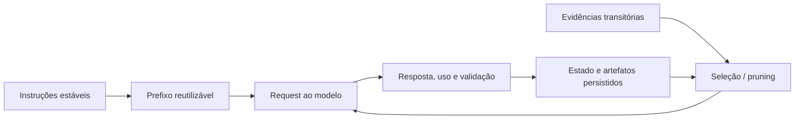

# Prompt caching e context pruning

## Fronteiras dos mecanismos

| Mecanismo | O que muda | O que continua necessário |
| --- | --- | --- |
| Prompt caching | Reutilização do processamento de um prefixo idêntico | Enviar a entrada exigida pela API e respeitar a janela de contexto |
| Context pruning | Seleção ou remoção de conteúdo do contexto ativo | Preservar requisitos e permitir recuperação das evidências removidas |
| Compactação | Substituição de histórico por uma representação menor | Conferir continuidade e recuperar detalhes que não ficaram no resumo |

Reduzir o tamanho de uma resposta de ferramenta antes de recebê-la é seleção de
contexto. Limpar uma resposta antiga é pruning. Gerar um resumo do histórico é
compactação. Eles podem participar do mesmo fluxo, mas não são intercambiáveis.



## Quando cache compensa

O caso favorável tem instruções ou referências estáveis, prefixo acima do mínimo
do modelo e repetição durante a vida útil do cache. Instruções iguais em posições
diferentes ou depois de conteúdo variável não garantem o mesmo prefixo.

Organize a requisição com invariantes primeiro e dados específicos da tarefa
depois. Não acrescente texto sem utilidade apenas para aumentar o prefixo e não
altere instruções antigas a cada turno para registrar progresso.

Para um prefixo de `P` tokens, considere tarifas por token: `r` para entrada comum,
`w` para escrita total de cache e `h` para leitura. Em uma escrita seguida de `k`
leituras, o prefixo custa `P × (w + k × h)`. Sem cache, custa
`P × (k + 1) × r`. Se `h < r`, a escrita é amortizada quando:

```text
k > (w - r) / (r - h)
```

A relação isola o prefixo: pressupõe mesmo conteúdo, um único preenchimento,
nenhuma expiração e nenhuma mudança de tarifa. Entrada variável e saída continuam
cobradas conforme o uso. Reescritas, múltiplos TTLs e diferenças entre modelos
exigem contabilização própria. As tarifas devem vir da tabela vigente do provedor.

## Quando pruning compensa

O caso favorável contém saídas grandes cujo valor diminuiu depois de extraídas as
conclusões: buscas, inspeções repetidas de arquivos e resultados intermediários.
O código atual deve ser relido do workspace; uma versão histórica relevante deve
ter referência imutável. Um caminho apontando para um arquivo que mudou não prova
que o resultado anterior é recuperável.

Antes de habilitar limpeza de resultados:

1. Preserve objetivo, restrições do usuário, decisões, pendências e resultado das
   verificações em estado persistido.
2. Defina quais ferramentas produzem conteúdo descartável. Exclua da limpeza as
   que fornecem requisitos ou informações que não podem ser reconstruídas.
3. Garanta acesso autorizado ao artefato por caminho/versionamento ou identificador
   verificável. Um nome de função ou resumo não substitui sua implementação.
4. Mantenha o trabalho em andamento e as evidências ainda necessárias disponíveis.
5. Teste retomada: o agente deve localizar a fonte, identificar mudanças e continuar
   sem inventar decisões ou resultados.

O preset Anthropic usa a política nativa de limpeza cronológica com exceções por
ferramenta. Ele não determina sozinho o que é semanticamente irrelevante. Se todas
as saídas precisam de recordação exata ou não são recuperáveis, não habilite a
política. No Codex, use seleção de arquivos e continuidade persistida; a remoção
efetiva do histórico pertence ao runtime.

## Como combinar sem anular os ganhos

Limpar conteúdo pode invalidar o cache a partir do ponto alterado. O custo de uma
nova escrita e da recuperação dos dados faz parte da decisão. A receita mantém
um breakpoint no sistema estável; não tenta cachear e reescrever o histórico ao
mesmo tempo. Preserve também a ordem e as definições das ferramentas quando forem
estáveis, pois elas participam do prefixo Anthropic.

Use limiares de limpeza que façam sentido para o workload. Os valores do preset
não foram calibrados para qualquer aplicação específica. Não reinicie ou compacte
uma sessão a cada mensagem como se isso fosse uma otimização universal.

## Como comprovar efetividade na sua carga

Compare tarefas representativas, com os mesmos critérios de aceitação:

| Variante | Cache | Pruning |
| --- | --- | --- |
| A | Desabilitado onde o provedor permite | Desabilitado |
| B | Habilitado | Desabilitado |
| C | Habilitado | Habilitado |

Separe execuções frias e quentes. Em ambientes com cache automático que não pode
ser desativado, registre os acertos observados; não chame essa execução de
baseline sem cache. Mudanças do modelo, concorrência e roteamento devem ser
registradas. No Codex, trate comparações entre sessões como observacionais se não
houver controle do cache.

Colete contagem por bucket, escritas, leituras, tokens limpos, tempo total,
releituras de fontes e sucesso da tarefa. Registre latência p50/p95 em uma amostra
suficiente, em vez de inferir desempenho de uma única resposta.

A métrica final é custo por tarefa aprovada pelos critérios funcionais, incluindo
tentativas malsucedidas e retrabalho. Redução de tokens sem preservação dos
requisitos não é ganho operacional. Tokens lidos do cache divididos pelos tokens
totais de entrada medem participação de tokens em cache, não taxa de acerto por
requisição.

## Referências técnicas

- [Anthropic: cache e invalidação](https://platform.claude.com/docs/en/build-with-claude/prompt-caching)
- [Anthropic: edição de contexto e métricas](https://platform.claude.com/docs/en/build-with-claude/context-editing)
- [Anthropic: engenharia de contexto](https://www.anthropic.com/research/effective-context-engineering-for-ai-agents)
- [OpenAI: parâmetros e comportamento do cache](https://developers.openai.com/api/docs/guides/prompt-caching)
